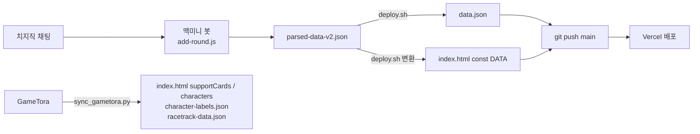

# 로그라이크 명예의 전당 (roguelikeportal)

우마무스메 로그라이크 레이스 모임의 회차별 기록을 보여 주는 정적 웹 포털입니다. 빌드 과정 없이 `index.html` 하나로 동작하며, Vercel이 `main` 브랜치를 그대로 배포합니다.

- 운영: https://roguelikeportal.vercel.app/
- 데이터 입력: 치지직 채팅을 수집하는 외부 봇이 기록을 만들고 이 저장소에 커밋합니다. 포털 자체에는 입력 기능이 없습니다.

## 화면 구성

| 영역 | 내용 |
|---|---|
| 종합 통계 | 누적 우승 순위, 우승·결승 진출 말딸 Top 10, 코스·거리·날씨·계절·마장·컨디션 분포를 집계합니다. |
| 회차별 기록 | 회차마다 코스·날씨·마장, 예선 대진, 결승 순위, 룰렛 결과와 코멘트를 보여 줍니다. |
| 참가자 상세 | 참가자 한 명의 순위 분포, 포디움 말딸 통계, 결승 진출 기록을 모아 봅니다. |
| 룰렛 | 서포트 카드·육성마 풀에서 조건에 맞게 뽑고 결과를 클립보드로 복사합니다. |
| 경기장 정보 | 한국 서버 경기장 코스 데이터와 코스별 유효 스킬을 조회합니다. |

## 파일

| 파일 | 역할 |
|---|---|
| `index.html` | 페이지 전체. 대시보드 데이터 `DATA`, 룰렛 풀 `supportCards`·`characters`, 경기장 `trackData`를 인라인 상수로 담고 있습니다. |
| `data.json` | 회차 기록 원본(`finals`, `matches` 형태). `DATA`는 배포 시 이 데이터를 변환해 주입한 사본입니다. |
| `archived-data.json` | 300회 이전(194회~)의 과거 기록 25건입니다. `index.html`은 참조하지 않고 보관용으로만 둡니다. |
| `champion.js` / `champion-core.mjs` / `champion.css` | 우승자 배너. `champion-core.mjs`가 우승자 선택·의상 매칭·대표색 계산을 맡고, `champion.js`가 DOM과 이미지 로드를 맡습니다. |
| `character-labels.json` | 육성마 `card_id`별 공식 이름·의상 타이틀·GameTora 출처입니다. |
| `racetrack-data.json` | 한국 서버 경기장 코스 스냅샷입니다. |
| `skill-by-track.json` | 코스별 유효 스킬 목록입니다. |
| `scripts/sync_gametora.py` | GameTora에서 신규 서포트 카드·육성마·경기장을 받아 `index.html` 상수와 라벨 파일을 갱신합니다. |
| `tests/champion-core.test.mjs` | 배너 로직 단위 테스트입니다. |
| `docs/` | 배너 설계(`champion.md`)와 작업 세션 요약(`sum/`)입니다. |

이미지는 이 저장소에 두지 않고 `keiaaskim/uma-race-system`의 `images/` 디렉터리를 raw URL로 참조합니다.

## 데이터 흐름



- 봇의 `deploy.sh`는 `parsed-data-v2.json`을 `data.json`으로 복사하고 `DATA`를 다시 만든 뒤 커밋·푸시합니다. 따라서 **기록을 정정할 때는 이 저장소와 봇의 원본을 함께 고쳐야** 다음 배포에서 되돌아가지 않습니다.
- 봇은 `uma-alias.json`의 별명 사전으로 채팅의 말딸 별명(`수키온` 등)을 등록부 이름(`아그네스타키온(수영복)`)으로 바꿔 기록합니다. 배너 이미지가 안 나오는 회차가 있으면 대개 이 사전에 없는 별명이 원인입니다.
- 완료된 회차는 결승에 `rank: 1`과 참가자 이름이 있는 기록으로 정의하고, 그중 가장 큰 회차 번호를 배너에 씁니다.

## 로컬 실행과 검증

```sh
python3 -m http.server 8769 --bind 127.0.0.1   # http://127.0.0.1:8769/index.html
node --test tests/champion-core.test.mjs
```

`fetch`로 JSON을 읽기 때문에 `file://`로 열면 라벨·경기장 데이터가 로드되지 않습니다.

## GameTora 동기화

```sh
python3 scripts/sync_gametora.py supports                  # 미리보기
python3 scripts/sync_gametora.py supports --apply --images-dir <uma-race-system>/images/support-cards
python3 scripts/sync_gametora.py characters --apply --images-dir <uma-race-system>/images/characters
python3 scripts/sync_gametora.py tracks --apply
```

기본 실행은 변경 없이 미리보기만 하고, `--apply`로 파일에 반영합니다. 세부 옵션은 스크립트 상단 docstring을 참고하세요.

## 라이선스

MIT (`LICENSE`). 캐릭터 이미지와 게임 데이터의 저작권은 Cygames에 있으며, 이 저장소는 비영리 모임 기록 용도로만 사용합니다.
